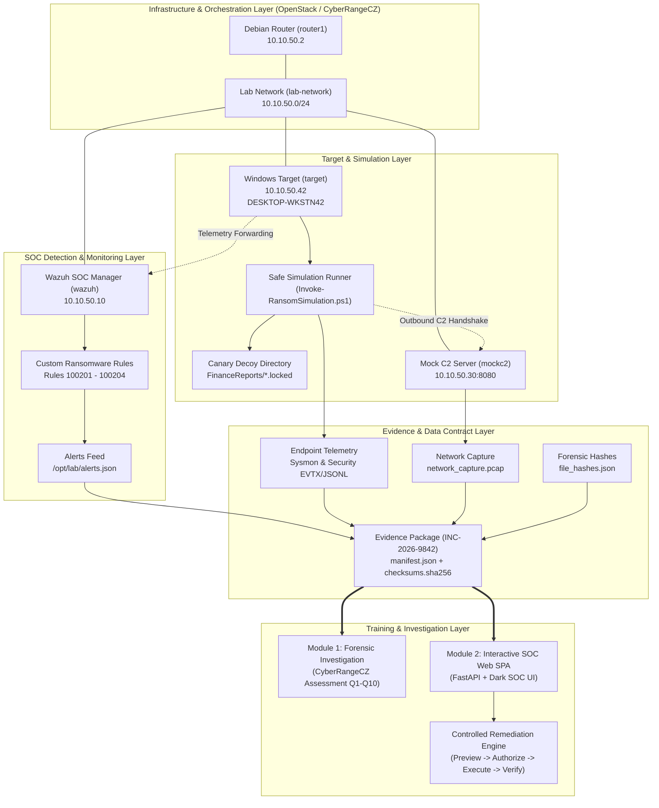

# System Architecture Specification

## 1. Architectural Philosophy & Core Tenets

The SOC CyberRange Ransomware Simulation & Interactive Investigation architecture is designed around evidence fidelity, deterministic reproducibility, absolute lab safety, and native interoperability with CyberRangeCZ (KYPO CRP).

---

## 2. Layer-by-Layer Architectural Breakdown

### 2.1 Infrastructure & Sandbox Layer
- **Orchestration:** Managed through CyberRangeCZ topology definition (`topology.yml`) and Ansible playbooks (`provisioning/playbook.yml`).
- **Network Segmentation:** Isolated CIDR `10.10.50.0/24`. All lab nodes communicate over private virtual networking behind a dedicated router (`10.10.50.2`).
- **Target Isolation:** The Windows endpoint has zero internet ingress/egress. Interservice traffic is restricted to the internal lab router and mock services.

### 2.2 Endpoint Simulation Layer
- **Target OS:** Windows 10 Pro 64-bit (Build 19045).
- **Emulation Principles:**
  - Strictly non-destructive, reversible cryptographic file modifications.
  - No credential dumping, no privilege escalation exploits, no unconstrained worm propagation.
  - Operation constrained to canary directory `C:\Users\j.doe\Documents\FinanceReports`.
  - Process creation reproduces authentic enterprise attack telemetry (Sysmon Event ID 1: `explorer.exe` -> `invoice_review.exe` -> `cmd.exe` -> `vssadmin.exe delete shadows /all /quiet`).

### 2.3 SOC Detection Layer
- **SIEM Manager:** Wazuh 4.14 All-in-One deployment (`10.10.50.10`).
- **Detection Logic:**
  - `100201` (Level 10): Suspicious binary launched from user `Downloads` directory.
  - `100202` (Level 12): Volume Shadow Copy deletion via `vssadmin.exe`.
  - `100203` (Level 14): Mass file renaming appending `.locked` and ransom note dropped.
  - `100204` (Level 9): Outbound connection to unclassified external port (8080).
- **Export Mechanism:** Continuous export to `/opt/lab/alerts.json` for trainee consumption.

### 2.4 Evidence & Data Contract Layer
- **Single Source of Truth:** `evidence/INC-2026-9842/`.
- Every generated artifact is indexed in `manifest.json` and validated against `checksums.sha256`.
- Rigorous separation of **Observed Facts**, **Derived Findings**, **Analyst Interpretations**, and **Assessment Criteria**.

### 2.5 Training & Investigation Layer
- **Module 1:** CyberRangeCZ platform assessment via `training_definition.json` evaluating trainee findings across 10 structured questions.
- **Module 2:** Standalone or integrated interactive dark SOC web application offering 8 guided lessons, an interactive process tree visualizer, PCAP payload inspector, Wazuh alert correlation cards, MITRE ATT&CK mapping, and a gated change-control remediation console.

