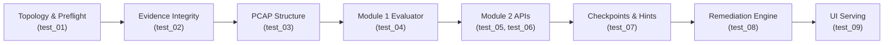

# Testing & Validation Suite

## 1. Test Architecture

The test suite provides industry-grade validation across infrastructure definitions, evidence generation, forensic artifact integrity, scoring, and the interactive web application.



---

## 2. Running Automated Tests

Run the full pytest suite:
```bash
python -m pytest -v tests/test_end_to_end.py
```

### Verified Test Cases:
1. `test_01_topology_validation`: Validates YAML syntax, host IP allocations, CIDR boundaries, and WinRM specifications.
2. `test_02_evidence_generation_and_integrity`: Rebuilds the evidence package and verifies all SHA-256 hashes against `checksums.sha256`.
3. `test_03_pcap_structure`: Parses raw packet bytes in `network_capture.pcap` to confirm valid Ethernet framing, TCP 3-way handshakes, and HTTP negotiation/beacon payloads.
4. `test_04_module1_assessment_evaluator`: Tests canonical assessment submissions (achieving 100/100 points) and verifies that bogus inputs are rejected.
5. `test_05_module2_api_incident_endpoints`: Validates `/api/incident` responses, timeline items, and metadata.
6. `test_06_module2_evidence_endpoints`: Tests query endpoints for processes, files, network, Wazuh alerts, and MITRE ATT&CK techniques.
7. `test_07_interactive_checkpoint_grading_and_hints`: Verifies real-time checkpoint submission, hint penalty deduction (-2 pts), and progress calculation.
8. `test_08_controlled_remediation_lifecycle`: Verifies action preview, confirmation gating, containment state updates, and post-remediation verification scanning.
9. `test_09_ui_serving`: Confirms the Single-Page Application HTML/CSS/JS is served successfully on the root endpoint.

