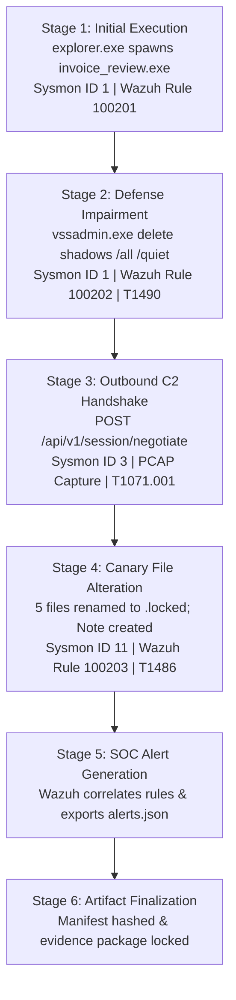

# Simulation Design & Execution Specification

## 1. Safety Architecture & Safeguards

The simulation design strictly enforces containment and non-destructiveness:
1. **No Real Malware Binaries:** Uses controlled PowerShell / Python runners that exhibit genuine behavioral heuristics without destructive payloads.
2. **Constrained Decoy Directory:** Operates exclusively within:
   `C:\Users\j.doe\Documents\FinanceReports` (or `$env:USERPROFILE\Documents\FinanceReports`).
   Never touches Windows system binaries, registry hives, user profiles, or volume root files.
3. **Reversible Cryptography:** Canary files are modified using a deterministic XOR-based reversible simulation (`LAB_REVERSIBLE_SIMULATION_KEY_2026!`). Original files are completely recoverable without introducing real destructive malware.
4. **Harmless Defense Impairment:** On live hosts, `vssadmin.exe list shadows` or controlled parameter execution is used rather than destroying actual operating system restore points.
5. **Isolated Mock C2:** C2 network traffic is routed only to `10.10.50.30:8080`, logging requests without external communication.

---

## 2. Six-Stage Fixed Attack Progression

### Stage 1: Initial Execution (T1204.002)
- Target: `DESKTOP-WKSTN42`
- User: `DESKTOP-WKSTN42\j.doe`
- Image: `C:\Users\j.doe\Downloads\invoice_review.exe`
- PID: 4912
- Parent: `C:\Windows\explorer.exe` (PID: 2840)
- SHA-256: `d4f5e71c890ab234cde567890f1234567890abcdef1234567890abcdef123456`
- Telemetry: Sysmon Event ID 1 / Windows Security 4688.

### Stage 2: Defense Impairment (T1490)
- Command: `vssadmin.exe delete shadows /all /quiet` (PID: 5288, Parent: 5120 `cmd.exe`).
- Telemetry: Sysmon Event ID 1.

### Stage 3: Outbound C2 Handshake (T1071.001, T1573.001)
- Source: `10.10.50.42:49812` -> Destination: `10.10.50.30:8080`
- Session negotiation: `POST /api/v1/session/negotiate` with header `X-Victim-ID: WKSTN42-99824`
- Server grants session token: `SES-98214-LOCK`
- Heartbeat beacon: `GET /api/v1/beacon?session=SES-98214-LOCK&status=encrypting`
- Telemetry: Sysmon Event ID 3, standard Ethernet PCAP capture.

### Stage 4: Controlled File Encryption (T1486)
- Files encrypted:
  1. `Q3_Financial_Audit.xlsx` -> `Q3_Financial_Audit.xlsx.locked`
  2. `Client_Contracts_2026.docx` -> `Client_Contracts_2026.docx.locked`
  3. `Employee_Payroll_Summary.pdf` -> `Employee_Payroll_Summary.pdf.locked`
  4. `Tax_Declaration_Draft.csv` -> `Tax_Declaration_Draft.csv.locked`
  5. `Customer_Database_Export.sql` -> `Customer_Database_Export.sql.locked`
- Extortion note: `C:\Users\j.doe\Documents\FinanceReports\RESTORE_FILES_INFO.txt`
- Telemetry: Sysmon Event ID 11 / Security 4663.

### Stage 5: SIEM Detection & Telemetry Forwarding
- Alerts generated in Wazuh Manager matching Rules `100201`, `100202`, `100203`, `100204`.

### Stage 6: Incident Packaging & Hash Manifestation
- Hashes computed using SHA-256.
- Manifest and checksums locked under `evidence/INC-2026-9842/`.

